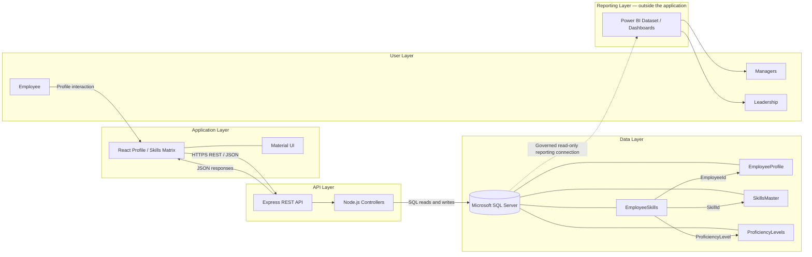

# Employee Skills Matrix — High-Level Architecture

**Purpose:** Architecture handover and draw.io recreation guide  
**Application stack:** React, Material UI, Node.js, Express.js, Microsoft SQL Server  
**Reporting stack:** Power BI, consuming SQL Server data outside the Skills Matrix application

## Architecture Components

| Layer | Major component | Responsibility |
|---|---|---|
| User Layer | Employee | Views profile and manages personal skills and proficiency. |
| User Layer | Manager and Leadership | Consume Skills Matrix analytics through Power BI dashboards; they do not use the Skills Matrix UI for these reports. |
| Application Layer | React Skills Matrix UI | Profile, skill cards, add/edit/delete dialogs, search, sorting, and proficiency display. |
| Application Layer | Material UI | Dialogs, form controls, menus, buttons, and other interface components. |
| API Layer | REST API (Express.js) | Exposes profile, skill catalogue, and employee-skill operations. |
| API Layer | Node.js controllers | Validate requests, apply application rules, and read/write SQL data. |
| Data Layer | Microsoft SQL Server | Transactional employee profile, skill catalogue, assignments, and proficiency definitions. |
| Reporting Layer | Power BI datasets and dashboards | Reads Skills Matrix data from SQL Server for analysis and visual reporting. This is outside the React application and its REST API. |

## Component Description

### User Layer

- **Employee:** Opens the Employee Profile, views assigned skills and proficiency, searches/sorts the list, and adds, edits, or deletes personal skill assignments.
- **Managers and Leadership:** Use Power BI dashboards for skill distribution, proficiency, category analysis, and other workforce views.

### Application Layer

The React Profile page is the employee-facing experience. Material UI provides dialog and form components. Search, sorting, and pagination are client-side operations on the loaded employee skill set; they do not require separate API endpoints.

### API Layer

Express routes dispatch requests to Node.js controllers. Controllers use the SQL access layer to retrieve or mutate profile and skill records. The API serves the application transaction flow; Power BI does not call these APIs for reporting.

### Data Layer

| Table | Purpose | Key relationships |
|---|---|---|
| `EmployeeProfile` | Employee profile attributes and identity. | `EmployeeId` is the profile key and identifies the employee associated with skill rows. |
| `EmployeeSkills` | Employee-to-skill assignments and proficiency level. | References `SkillsMaster.SkillId` and `ProficiencyLevels.ProficiencyLevelId`; contains `EmployeeId`. |
| `SkillsMaster` | Selectable skills and their categories. | One catalogue row can be assigned to many employees. |
| `ProficiencyLevels` | Standard proficiency level names/descriptions, levels 1–5. | One proficiency level can be used by many employee-skill assignments. |

The employee relationship can be represented in reporting as `EmployeeProfile.EmployeeId` to `EmployeeSkills.EmployeeId`. Confirm/create a database foreign key if referential integrity is required by the target deployment.

### Reporting Layer

Power BI connects to SQL Server through a governed dataset/data source and reads the profile, assignment, skill catalogue, and proficiency tables. The reporting connection should use a read-only SQL identity and only expose approved fields. Row-level security should be applied if reports vary by manager, organization, or leadership scope. These are reporting deployment controls, not functionality implemented by the React application.

## Data Flow

### Transactional Application Flow

1. Employee opens Profile in the React application.
2. React calls the REST API for profile data and the employee's skill assignments. The Add Skill dialog also loads available skills from the catalogue endpoint.
3. Express routes the requests to Node.js controllers.
4. Controllers read or write SQL Server through the database access layer.
5. SQL Server returns results or commits the requested assignment change.
6. The API returns JSON to React; React renders or refreshes the profile/skill cards.
7. Add, edit, and delete operations refresh the employee's skill list after success.

### Reporting Flow

1. Skills Matrix transactions persist data in SQL Server.
2. Power BI dataset refresh or DirectQuery reads approved data directly from SQL Server through its configured data source.
3. Power BI models the profile, employee-skill, catalogue, and proficiency relationships.
4. Managers and Leadership consume dashboards in Power BI.

**Reporting is separate from the transactional API flow:** Power BI reads SQL Server data; it does not call the React application or Skills Matrix REST endpoints.

## Mermaid Diagram



## Draw.io Layout Suggestion

Use a landscape canvas with five horizontal swim lanes stacked vertically, or five vertical containers arranged left to right. A left-to-right layout makes the two flows easy to distinguish:

1. **User Layer (left):** Employee actor above; Manager and Leadership actors below, grouped as Power BI consumers.
2. **Application Layer:** One React Profile / Skills Matrix container. Inside, show Profile, Skills list/cards, Add/Edit/Delete dialogs, and client-side Search/Sort. Place a small Material UI label within the container.
3. **API Layer:** Express REST API connected to Node.js Controllers. Label the connector `HTTPS + JSON`.
4. **Data Layer:** SQL Server cylinder with four table boxes: `EmployeeProfile`, `EmployeeSkills`, `SkillsMaster`, `ProficiencyLevels`. Draw relationship lines from `EmployeeSkills` to the other three tables, labeling the keys.
5. **Reporting Layer (far right or lower lane):** Power BI Dataset and Dashboards; connect it directly to SQL Server with a **dashed** arrow labeled `Read-only SQL / refresh or DirectQuery`. Connect Managers and Leadership to the Power BI box.

### Connector Legend

- **Solid arrows:** Interactive transactional request/response path: Employee → React → REST API → Node.js → SQL Server, with JSON responses returning to React.
- **Dashed arrow:** Reporting data access: SQL Server → Power BI.
- Keep Power BI visually outside the React/REST application boundary to emphasize it does not use the Skills Matrix API for analytics.

### Suggested draw.io Labels

- Transactional flow: `View Profile`, `Add Skill`, `Update Proficiency`, `Delete Skill`, `JSON response`
- Reporting flow: `Dataset refresh / DirectQuery`, `Skill distribution`, `Proficiency analysis`, `Category analysis`
- Data relationships: `EmployeeId`, `SkillId`, `ProficiencyLevelId`

## Reporting Examples

Power BI dashboards can use the Skills Matrix tables to present:

- Skill distribution by organization, team, or department.
- Competency and proficiency-level breakdowns.
- Top skills and category-wise skill analysis.
- Skills coverage and gaps for planning.

These are reporting examples, not application endpoints or reports delivered by the React feature itself.

## Architecture Notes

- Use authenticated employee identity for the Profile and skill API calls; do not rely on a hard-coded employee ID in production.
- Scope employee skill reads and writes to the authenticated identity or authorized role.
- Keep Power BI credentials read-only and governed independently from the application’s ODBC credentials.
- The Power BI data model and row-level security policy should be owned by the reporting team and validated against organizational access rules.
- Client-side search/sort improves the user experience but is not a substitute for backend access control.
```
