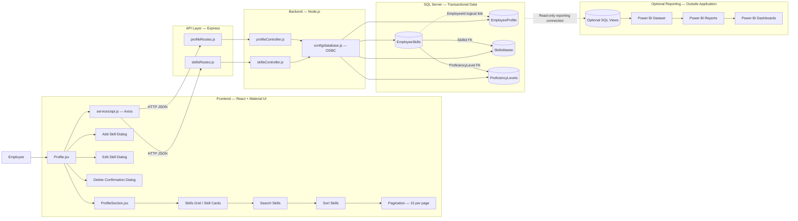

# Employee Skills Matrix — Low-Level Design

**Feature:** Skills Matrix & Competencies  
**Frontend:** React, Material UI  
**Backend:** Node.js, Express.js  
**Database:** Microsoft SQL Server  
**Reporting:** Optional SQL views and Power BI, outside the transaction application

## 1. Scope and Boundaries

This LLD describes the employee-facing Profile/Skills Matrix flow: load the employee profile, load skill assignments and catalogue options, and add/edit/delete assignments. Search, sorting, and pagination are client-side. Power BI is a separate reporting consumer of SQL Server data; it is not called by the React application.

The application currently uses employee ID `INT001` in `Profile.jsx`. Production integration should obtain employee identity from the host application's authenticated context.

## 2. Component Diagram



**Implementation note:** `EmployeeSkills.EmployeeId` is a logical relation in the supplied scripts; no FK to `EmployeeProfile.EmployeeId` is currently defined. `getEmployeeSkills` currently does not filter the SQL by the supplied employee ID. Add `WHERE es.EmployeeId = ?` and validate isolation before production use.

## 3. Component Responsibilities

### 3.1 Frontend

| Component | Responsibility | Important state / inputs |
|---|---|---|
| `Profile.jsx` | Orchestrates profile/skill loading, display, operations, search, sort, pagination, dialogs, and toasts. | `profile`, `skills`, `allSkills`, `searchTerm`, `sortOption`, `currentPage`, `selectedSkill`, `newLevel`, `skillToEdit`, `editingLevel`, `skillToDelete`, dialog flags. |
| `ProfileSection.jsx` | Reusable collapsible section wrapper; accepts title, icon, children, open default, and optional DOM `id`. | `open` state. Skills section uses `id="skills-section"`. |
| Skills Grid | Renders `paginatedSkills`; card shows SkillName, Category, proficiency indicator, tooltip, Edit/Delete actions. | Derived from `skills` and current view state. |
| Search Skills | TextField; trims and lowercases query; matches SkillName or Category. | `searchTerm`; resets page to 1 when changed. |
| Sort Skills | Material UI Select with proficiency/name/category order choices. | `sortOption`; resets page to 1 when changed. |
| Pagination | Displays 15 sorted/filtered rows per page, page navigation and range count. | `currentPage`, derived `totalPages`, `paginatedSkills`. |
| Add Skill Dialog | Autocomplete from active catalogue and proficiency dropdown; validates selections before POST. | `selectedSkill`, `newLevel`, `addDialogOpen`. |
| Edit Skill Dialog | Read-only skill name and preselected proficiency; saves via PUT. | `skillToEdit`, `editingLevel`, `editDialogOpen`. |
| Delete Confirmation Dialog | Confirms destructive assignment removal before DELETE. | `skillToDelete`, `deleteDialogOpen`. |
| API Service | Axios calls to profile, employee-skill, and catalogue endpoints. | `frontend/src/services/api.js`. |

### 3.2 Backend

| Component | Responsibility |
|---|---|
| `profileRoutes.js` | Routes profile lookup, employee skills, and assignment CRUD under `/api/profile`. |
| `skillsRoutes.js` | Routes skill catalogue read under `/api/skills`. |
| `profileController.js` | Profile lookup and EmployeeSkills read/insert/update/delete. |
| `skillsController.js` | Returns active SkillsMaster catalogue rows. |
| `database.js` | Opens ODBC connections and exposes `all`, `get`, and `run` SQL helpers. |

### 3.3 Database

| Table | Keys and role |
|---|---|
| `EmployeeProfile` | PK: `EmployeeId`; stores employee details rendered by Profile. |
| `SkillsMaster` | PK: `SkillId` identity; unique skill catalogue with `SkillName`, `Category`, and `IsActive`. |
| `EmployeeSkills` | PK: `EmployeeSkillId` identity; assignment with `EmployeeId`, `SkillId`, `ProficiencyLevel`, audit metadata. |
| `ProficiencyLevels` | PK: `ProficiencyLevelId` values 1–5; stores `LevelName` and `Description`. |

Logical/foreign-key relationships:

```text
EmployeeProfile.EmployeeId 1 ── * EmployeeSkills.EmployeeId (logical in current SQL)
SkillsMaster.SkillId       1 ── * EmployeeSkills.SkillId (FK)
ProficiencyLevels.ProficiencyLevelId 1 ── * EmployeeSkills.ProficiencyLevel (intended FK)
```

### 3.4 Reporting (Optional)

An optional reporting path may add views over employee assignments and master tables, then connect a Power BI Dataset to SQL Server. Power BI Reports and Dashboards consume that dataset. No SQL views, Power BI dataset, or reports are included in the current application implementation.

Suggested logical view shape:

```sql
-- Design sketch only; not an existing view.
SELECT
    ep.EmployeeId,
    ep.EmployeeName,
    ep.Department,
    sm.SkillId,
    sm.SkillName,
    sm.Category,
    pl.ProficiencyLevelId,
    pl.LevelName
FROM dbo.EmployeeSkills AS es
JOIN dbo.EmployeeProfile AS ep
  ON ep.EmployeeId = es.EmployeeId
JOIN dbo.SkillsMaster AS sm
  ON sm.SkillId = es.SkillId
JOIN dbo.ProficiencyLevels AS pl
  ON pl.ProficiencyLevelId = es.ProficiencyLevel;
```

Expose reporting data through a read-only identity, and define Power BI row-level security if manager/leadership audiences have different access scopes.

## 4. Data Flow

### 4.1 Profile and Skills Load

1. `Profile` mounts and calls `getEmployeeProfile`, `getEmployeeSkills`, and `getSkills`.
2. `api.js` issues HTTP GET requests.
3. Express dispatches via `profileRoutes.js` or `skillsRoutes.js`.
4. Controllers query SQL Server through `database.js`.
5. API returns JSON; React stores profile, assigned skills, and catalogue options.
6. UI renders profile fields and cards.

### 4.2 Search, Sort, Pagination

```text
skills state
  → filteredSkills (trimmed, case-insensitive name/category match)
  → sortedSkills (selected proficiency/name/category comparator)
  → paginatedSkills (15 items per page)
  → Skill Cards Grid
```

This flow is browser-only; it does not call the backend. Search and sort reset the current page to 1. If result count shrinks below the current page, current page is clamped.

### 4.3 Add Skill Request/Response Cycle

```text
Employee → Add dialog → React handler → Axios POST
  → Express profile route → profileController.addEmployeeSkill
  → EmployeeSkills duplicate lookup → SQL INSERT
  ← 201 success / 400 duplicate / 500 database failure
  ← Close dialog, refresh GET employee skills, show Toastify result
```

Request body:

```json
{
  "employeeId": "INT001",
  "skillId": 12,
  "proficiencyLevel": 4
}
```

### 4.4 Edit Skill Request/Response Cycle

```text
Employee → Edit dialog → React handler → Axios PUT /api/profile/skills/:id
  → Controller validates level, reads assignment, updates proficiency/audit fields
  ← 200 success / 400 invalid level / 404 missing assignment / 500 DB error
  ← Refresh employee skill list, close dialog, show Toastify result
```

Body: `{ "proficiencyLevel": 5 }`.

### 4.5 Delete Skill Request/Response Cycle

```text
Employee → Delete confirmation → React handler → Axios DELETE /api/profile/skills/:id
  → Controller deletes EmployeeSkills row
  ← 200 success / 500 DB error
  ← Refresh employee skill list, close confirmation, show Toastify result
```

### 4.6 Reporting Flow

```text
EmployeeSkills + EmployeeProfile + SkillsMaster + ProficiencyLevels
  ↓
SQL Server
  ↓ (optional read-only SQL connection / views)
Power BI Dataset
  ↓
Power BI Reports
  ↓
Power BI Dashboards for authorized consumers
```

Reporting is outside the Skills Matrix React application and uses a database reporting connection, not the Skills Matrix REST APIs.

## 5. API Contracts Used by the Feature

| Method | Route | Used for |
|---|---|---|
| GET | `/api/profile/:employeeId` | Employee profile load. |
| GET | `/api/profile/skills/:employeeId` | Employee assigned skills with category and proficiency labels. |
| GET | `/api/skills` | Active catalogue options for Add Skill. |
| POST | `/api/profile/skills` | Create employee-skill assignment. |
| PUT | `/api/profile/skills/:id` | Update proficiency by `EmployeeSkillId`. |
| DELETE | `/api/profile/skills/:id` | Delete assignment by `EmployeeSkillId`. |

### Add Skill

```http
POST /api/profile/skills
Content-Type: application/json
```

```json
{
  "employeeId": "INT001",
  "skillId": 12,
  "proficiencyLevel": 4
}
```

### Update Skill

```http
PUT /api/profile/skills/42
Content-Type: application/json
```

```json
{ "proficiencyLevel": 5 }
```

### Typical Responses

```json
{ "message": "Skill added successfully" }
```

```json
{ "message": "Skill updated successfully" }
```

```json
{ "message": "Skill deleted successfully" }
```

Errors currently include duplicate-add `400`, proficiency validation `400`, missing update assignment `404`, and database failures `500`. Delete does not currently check affected rows or return `404` when the assignment ID is absent.

## 6. Sequence Diagram

```mermaid
sequenceDiagram
    actor Employee
    participant UI as React Profile / Skills UI
    participant API as Axios API Service
    participant Routes as Express Routes
    participant Controller as Node.js Controller
    participant DB as SQL Server

    Employee->>UI: Open Profile
    par Load profile
        UI->>API: GET /api/profile/:employeeId
        API->>Routes: HTTP GET
        Routes->>Controller: getEmployeeProfile
        Controller->>DB: SELECT EmployeeProfile by EmployeeId
        DB-->>Controller: Profile row
        Controller-->>API: 200 JSON / 404 / 500
        API-->>UI: Profile result
    and Load employee skills
        UI->>API: GET /api/profile/skills/:employeeId
        API->>Routes: HTTP GET
        Routes->>Controller: getEmployeeSkills
        Controller->>DB: SELECT assignments + catalogue + proficiency
        DB-->>Controller: Skill rows
        Controller-->>API: 200 JSON / 500
        API-->>UI: Skill array
    and Load catalogue
        UI->>API: GET /api/skills
        API->>Routes: HTTP GET
        Routes->>Controller: getSkills
        Controller->>DB: SELECT active SkillsMaster rows
        DB-->>Controller: Catalogue rows
        Controller-->>API: 200 JSON / 500
        API-->>UI: Skill options
    end

    Employee->>UI: Search / Sort / Change page
    UI->>UI: Filter → Sort → Slice 15 items
    Note over UI: Client-side only; no API request

    opt Add skill
        Employee->>UI: Select skill and proficiency; submit
        UI->>API: POST /api/profile/skills
        API->>Routes: HTTP POST
        Routes->>Controller: addEmployeeSkill
        Controller->>DB: Check duplicate, INSERT EmployeeSkills
        DB-->>Controller: Insert result
        Controller-->>API: 201 / 400 duplicate / 500
        API-->>UI: Result
        UI->>API: GET /api/profile/skills/:employeeId (refresh)
    end

    opt Edit proficiency
        Employee->>UI: Save proficiency
        UI->>API: PUT /api/profile/skills/:id
        API->>Routes: HTTP PUT
        Routes->>Controller: updateEmployeeSkill
        Controller->>DB: Validate assignment, UPDATE proficiency
        DB-->>Controller: Update result
        Controller-->>API: 200 / 400 / 404 / 500
        API-->>UI: Result
        UI->>API: GET /api/profile/skills/:employeeId (refresh)
    end

    opt Delete skill
        Employee->>UI: Confirm delete
        UI->>API: DELETE /api/profile/skills/:id
        API->>Routes: HTTP DELETE
        Routes->>Controller: deleteEmployeeSkill
        Controller->>DB: DELETE EmployeeSkills row
        DB-->>Controller: Delete result
        Controller-->>API: 200 / 500
        API-->>UI: Result
        UI->>API: GET /api/profile/skills/:employeeId (refresh)
    end
```

## 7. Draw.io Layout Suggestion

Create a landscape page with four main columns and an optional reporting lane:

1. **Employee** actor at far left.
2. **Frontend container**: Profile.jsx, ProfileSection.jsx, Skills Grid, Add/Edit/Delete Dialogs, and a grouped Search → Sort → Pagination block. Show Material UI as the UI toolkit.
3. **API container**: Axios Service Layer, then Express routes (`profileRoutes.js`, `skillsRoutes.js`). Label the request arrows with HTTP verbs/routes.
4. **Backend container**: Controllers (`profileController.js`, `skillsController.js`) and `database.js` ODBC helper.
5. **Data container**: SQL Server cylinder containing EmployeeProfile, EmployeeSkills, SkillsMaster, and ProficiencyLevels. Draw FK lines from EmployeeSkills to SkillsMaster and ProficiencyLevels; use a dashed logical EmployeeId link to EmployeeProfile if no FK exists.
6. **Optional reporting lane** beneath/right: SQL Views → Power BI Dataset → Power BI Reports → Power BI Dashboards. Connect SQL Server to this lane with a dashed read-only reporting connector, not through Express.

Use solid directional arrows for transactional HTTP/SQL flow; dashed arrows for optional reporting and logical relationships. Add a legend and note that search/sort/pagination remain inside the frontend boundary.

## 8. Implementation Notes and Risks

- Profile page currently uses a fixed `EMPLOYEE_ID = "INT001"`; replace it with authenticated employee context when integrating.
- Current `getEmployeeSkills` controller SQL does not contain `WHERE es.EmployeeId = ?`, despite accepting the employee ID path parameter. Add this predicate and test employee isolation before release.
- The current employee-skills GET query runs without `allSkills` filtering; active catalogue lookup is separate at `GET /api/skills`.
- Database scripts are a mix of DDL, seed, and manual alteration statements; inspect them before applying to shared databases. Some scripts include `TRUNCATE`, `DELETE`, unguarded `ALTER`, or column-renaming steps. Do not blindly rerun in production.
- Current database helper opens/closes an ODBC connection per operation. Its `formatQuery` helper substitutes `?` placeholders as SQL literals; production hardening should use driver parameter binding.
- The current APIs have no authentication/authorization. Enforce ownership and role policy server-side before production use.
- No Power BI views, dataset, report, or dashboard are included in the application; these are separate optional reporting deliverables.
``