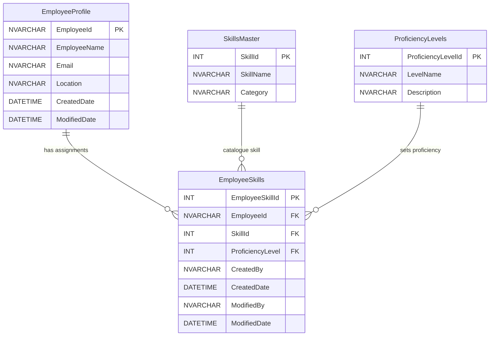
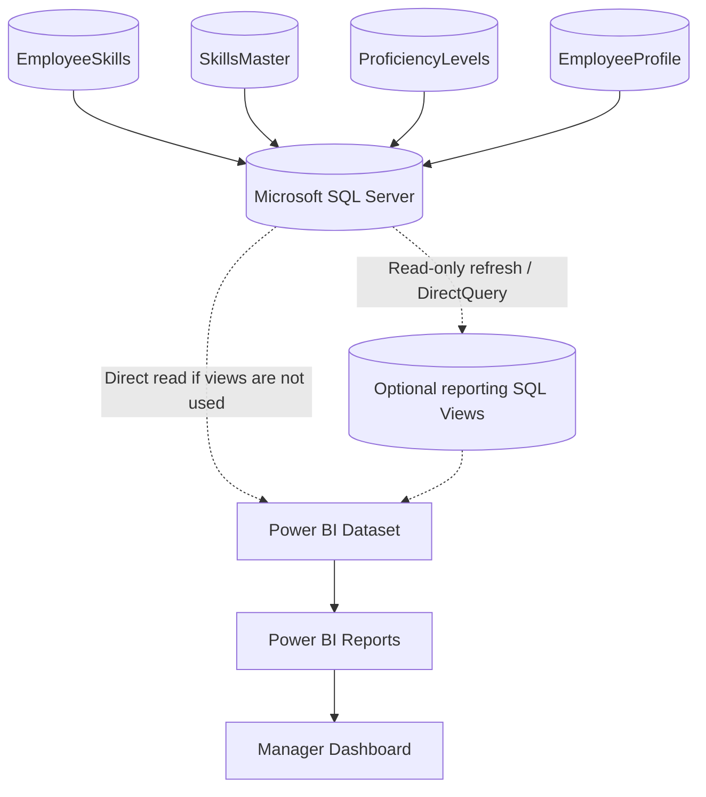

# Skills Matrix — ER Diagram and Sequence Flows

**System:** Employee Skills Matrix  
**Application stack:** React + Material UI, Node.js + Express.js  
**Data store:** Microsoft SQL Server  
**Reporting:** Power BI consuming SQL Server data outside the application

## 1. ER Diagram Description

`EmployeeSkills` is the associative/transaction table connecting employees, skill catalogue entries, and proficiency levels. Each row represents one skill assigned to one employee at one proficiency level.

| Table | Primary key | Foreign keys | Role |
|---|---|---|---|
| `EmployeeProfile` | `EmployeeId` | — | Employee identity/profile record. |
| `SkillsMaster` | `SkillId` | — | Reusable skill names and categories. |
| `ProficiencyLevels` | `ProficiencyLevelId` | — | Reusable proficiency names and descriptions. |
| `EmployeeSkills` | `EmployeeSkillId` | `EmployeeId` → `EmployeeProfile.EmployeeId`; `SkillId` → `SkillsMaster.SkillId`; `ProficiencyLevel` → `ProficiencyLevels.ProficiencyLevelId` | Employee-to-skill assignment and proficiency. |

### Cardinality

- One `EmployeeProfile` can have zero or many `EmployeeSkills` rows. Each assignment belongs to one employee.
- One `SkillsMaster` entry can appear in zero or many `EmployeeSkills` rows. Each assignment references one catalogue skill.
- One `ProficiencyLevels` row can be used by zero or many `EmployeeSkills` rows. Each assignment references one proficiency level.
- Therefore, employees and skills have a many-to-many relationship resolved by `EmployeeSkills`; the proficiency foreign key describes each employee-skill association.

### Mermaid ER Diagram



**Schema note:** This diagram follows the requested logical model. Confirm physical constraints in the target SQL database: the current scripts define FKs to SkillsMaster and ProficiencyLevels, but EmployeeId may be only a logical relationship unless an EmployeeProfile FK has been added. The supplied scripts have also been revised over time; confirm final column names and ensure runtime code uses `ProficiencyLevel` (not a renamed `ProficiencyLevelId` column).

## 2. CRUD Sequence Diagram

The API calls shown correspond to the application routes. Search and sorting are client-side and do not appear as network calls. The React UI refreshes the employee skill list after a successful mutation.

```mermaid
sequenceDiagram
    autonumber
    actor Employee
    participant UI as React Profile / Skills UI
    participant API as Axios API Service
    participant Route as Express Route
    participant Controller as profileController
    participant DB as SQL Server

    Employee->>UI: Open Profile
    UI->>API: GET /api/profile/:employeeId
    API->>Route: HTTP GET profile
    Route->>Controller: getEmployeeProfile
    Controller->>DB: SELECT EmployeeProfile by EmployeeId
    DB-->>Controller: Profile row
    Controller-->>API: 200 profile / 404 / 500
    API-->>UI: Profile JSON

    UI->>API: GET /api/profile/skills/:employeeId
    API->>Route: HTTP GET employee skills
    Route->>Controller: getEmployeeSkills
    Controller->>DB: SELECT EmployeeSkills joined to SkillsMaster and ProficiencyLevels
    DB-->>Controller: Assignment rows
    Controller-->>API: 200 rows / 500
    API-->>UI: Skills JSON

    UI->>API: GET /api/skills
    API->>Route: HTTP GET catalogue
    Route->>Controller: getSkills
    Controller->>DB: SELECT active SkillsMaster rows
    DB-->>Controller: Catalogue rows
    Controller-->>API: 200 rows / 500
    API-->>UI: Skill options

    opt Add Skill
        Employee->>UI: Choose skill and proficiency; confirm Add
        UI->>API: POST /api/profile/skills {employeeId, skillId, proficiencyLevel}
        API->>Route: HTTP POST
        Route->>Controller: addEmployeeSkill
        Controller->>DB: Check duplicate employee/skill pair
        DB-->>Controller: Existing row or none
        alt Duplicate assignment
            Controller-->>API: 400 Skill already exists
            API-->>UI: Show error notification
        else New assignment
            Controller->>DB: INSERT EmployeeSkills
            DB-->>Controller: Insert result
            Controller-->>API: 201 Skill added
            API-->>UI: Show success notification
            UI->>API: GET /api/profile/skills/:employeeId (refresh)
            API-->>UI: Updated skill list
        end
    end

    opt Edit Skill
        Employee->>UI: Choose new proficiency and Save
        UI->>API: PUT /api/profile/skills/:id {proficiencyLevel}
        API->>Route: HTTP PUT
        Route->>Controller: updateEmployeeSkill
        Controller->>DB: Check assignment and update proficiency/audit fields
        DB-->>Controller: Update result
        Controller-->>API: 200 updated / 400 invalid level / 404 missing / 500
        API-->>UI: Show result notification
        UI->>API: GET /api/profile/skills/:employeeId (refresh on success)
        API-->>UI: Updated skill list
    end

    opt Delete Skill
        Employee->>UI: Confirm delete
        UI->>API: DELETE /api/profile/skills/:id
        API->>Route: HTTP DELETE
        Route->>Controller: deleteEmployeeSkill
        Controller->>DB: DELETE EmployeeSkills assignment
        DB-->>Controller: Delete result
        Controller-->>API: 200 deleted / 500
        API-->>UI: Show result notification
        UI->>API: GET /api/profile/skills/:employeeId (refresh on success)
        API-->>UI: Updated skill list
    end
```

## 3. Power BI Reporting Flow

Power BI is a separate reporting consumer. It reads the SQL Server data through a governed dataset connection; it does not use React, the Skills REST API, or the Node.js controller path for analytics.



Example report subjects include skill distribution, competency/proficiency analysis, top skills, and category-wise analysis. SQL views are optional and are not part of the current Skills application API.

## 4. Draw.io Layout Instructions

### ERD Page

1. Place four table/entity boxes in a diamond or left-to-right arrangement: `EmployeeProfile`, `SkillsMaster`, and `ProficiencyLevels` around `EmployeeSkills`.
2. Put `EmployeeSkills` in the center/bottom as the associative table.
3. Mark PK/FK suffixes directly beside the listed fields.
4. Draw crow’s-foot connectors:
   - `EmployeeProfile.EmployeeId` **1** to `EmployeeSkills.EmployeeId` **0..many**.
   - `SkillsMaster.SkillId` **1** to `EmployeeSkills.SkillId` **0..many**.
   - `ProficiencyLevels.ProficiencyLevelId` **1** to `EmployeeSkills.ProficiencyLevel` **0..many**.
5. Use solid connectors for enforced database FKs and dashed connector for any logical relationship not enforced by a physical FK.
6. Place an external Power BI reporting container to the right of SQL Server. Connect the four source tables through SQL Server to an optional Views box, Dataset, Reports, and Dashboard using dashed arrows labelled `read-only reporting`.

### CRUD Sequence Page

1. Arrange lifelines left-to-right: Employee, React Profile UI, Axios API Service, Express Route, `profileController`, SQL Server.
2. Add the initial Profile/Skills/Catalogue reads at the top.
3. Draw separate `opt` frames for Add, Edit, and Delete.
4. In Add, include an `alt` frame for duplicate assignment (400) versus successful insert (201).
5. Show list refresh after successful mutations.
6. Add response/status labels beside controller return arrows (200/201/400/404/500).
7. Keep client-side search/sort out of the API sequence; show them as a note inside the React lifeline.

### Reporting Sequence Page

1. Place the four SQL table sources grouped inside the SQL Server boundary.
2. Place optional SQL views, Power BI Dataset, Power BI Reports, and Manager Dashboard to the right.
3. Use a dashed, read-only arrow from SQL Server/views to the Dataset; then solid arrows from Dataset to Reports and Dashboard.
4. Add a note: `Reporting flow is outside the Skills Matrix application/API.`

## 5. Implementation Caveats

- The current `getEmployeeSkills` controller query has no `WHERE es.EmployeeId = ?` filter, although the route takes an employee ID. Add the filter and verify data isolation before production use.
- Profile currently uses hard-coded employee ID `INT001`; integrate with authenticated user identity.
- The existing SQL scripts include development alterations/seeds and should be reconciled before production migration.
- The current API has no authentication or authorization enforcement. Power BI access also needs its own read-only credentials and, where needed, row-level security.
